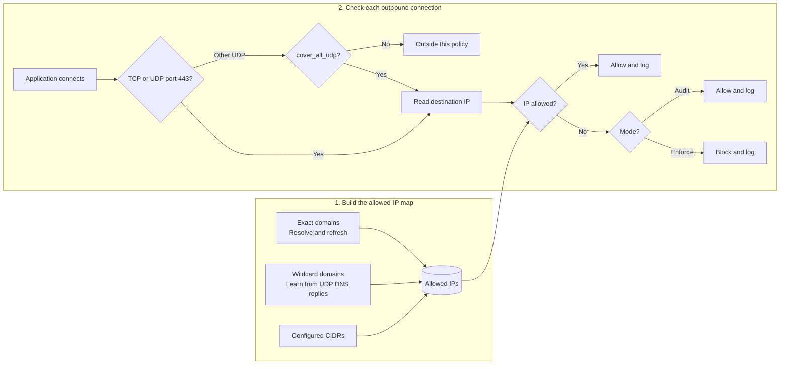

# outbound

`outbound` is a Linux egress monitor and policy enforcer built with eBPF. It records outbound destinations in **audit** mode and can block destinations outside an allowlist in **enforce** mode. The release includes Linux `amd64` (`x86_64`) and `arm64` (`aarch64`) binaries, a sample config, a systemd unit, and a logrotate policy.

It needs a compatible Linux kernel (5.17 or newer), cgroup v2, systemd, and permission to load eBPF programs. The supplied service uses `CAP_BPF`, `CAP_NET_ADMIN`, and `CAP_PERFMON`. It does not require a proxy, changes to the VM's DNS settings, nftables, or UFW.

The current release pipeline targets Ubuntu runners on `amd64` and `arm64`. Other distributions may work when their kernels provide the required eBPF features, but they are not covered by a distribution test matrix yet. Test the exact target kernel before enabling enforcement.
The workflow disables CGO and rejects binaries that require a dynamic linker, so the release binary does not depend on the runner's glibc version.

## How it works



The hooks cover TCP connections on any port and UDP destination port 443 (QUIC/HTTP/3). Set `cover_all_udp: true` to cover other UDP ports too. Exact domains are resolved at startup and refreshed at `dns_refresh_interval`. Wildcards such as `*.amazonaws.com` learn matching A/AAAA addresses from observed ordinary UDP DNS replies; the wildcard does not include `amazonaws.com` itself. Learned addresses follow their DNS TTL, capped at one hour.

The final decision uses the **destination IP**, so a direct connection to an IP already allowed through a domain or CIDR can still succeed. An allowed IP may also host a different site or proxy. DNS over HTTPS, DNS over TLS, DNS over TCP, and application caches do not supply names to the UDP DNS observation hook.

### SSH and other TCP ports

The policy applies to **all outbound TCP ports**, including SSH on port 22. In `enforce` mode, adding an EC2 instance's IP to `allowlist.cidrs` allows outbound SSH to that IP. The same CIDR also permits other TCP ports on that IP; CIDRs are not port-specific. For a single IPv4 destination, use a `/32` prefix:

```yaml
allowlist:
  cidrs:
    - "203.0.113.10/32" # Replace with the EC2 instance's actual IP.
```

This hook does not block inbound SSH to the VM. The destination's security group, firewall, and SSH service must also allow the connection.

## Manual installation on Ubuntu

Choose a published release tag and run these commands **on the target VM**. The commands select the correct binary for Ubuntu x86_64 or aarch64.

```sh
VERSION=v0.1.1
REPO=opsbento/outbound
case "$(uname -m)" in
  x86_64) ARCH=amd64 ;;
  aarch64) ARCH=arm64 ;;
  *) echo "Unsupported architecture: $(uname -m)" >&2; exit 1 ;;
esac
ASSET="outbound-${VERSION}-linux-${ARCH}"
BASE="https://github.com/${REPO}/releases/download/${VERSION}"
curl -fL --retry 3 -O "${BASE}/${ASSET}"
curl -fL --retry 3 -O "${BASE}/${ASSET}.sha256"
curl -fL --retry 3 -O "${BASE}/config.example.yaml"
curl -fL --retry 3 -O "${BASE}/outbound.service"
curl -fL --retry 3 -O "${BASE}/outbound.logrotate"
curl -fL --retry 3 -O "${BASE}/LICENSE"
curl -fL --retry 3 -O "${BASE}/SHA256SUMS"
sha256sum --check "${ASSET}.sha256"
sha256sum --ignore-missing --check SHA256SUMS
```

Stop if any download or the checksum check fails. Inspect `config.example.yaml` and `outbound.service` before installing them. Create the service account and install the files:

```sh
sudo groupadd --system --force outbound
id -u outbound >/dev/null 2>&1 || sudo useradd --system --no-create-home --shell /usr/sbin/nologin --gid outbound outbound
sudo install -d -m 0755 /etc/outbound
sudo install -d -o outbound -g outbound -m 0750 /var/log/outbound
mountpoint --quiet /sys/fs/bpf || { echo "bpffs is not mounted" >&2; exit 1; }
sudo install -d -o outbound -g outbound -m 0700 /sys/fs/bpf/outbound
sudo install -m 0755 "$ASSET" /usr/local/bin/outbound
sudo install -m 0644 config.example.yaml /etc/outbound/config.yaml
sudo install -m 0644 outbound.service /etc/systemd/system/outbound.service
sudo install -m 0644 outbound.logrotate /etc/logrotate.d/outbound
sudo /usr/local/bin/outbound --check-config --config /etc/outbound/config.yaml
sudo systemctl daemon-reload
sudo systemctl enable --now outbound.service
```

The sample config starts in `audit` mode, so installation initially observes traffic without blocking it. Its domains and CIDRs are examples; replace them before enabling enforcement. To upgrade manually, verify the new release's binary and replace `/usr/local/bin/outbound`, then run `sudo systemctl restart outbound`. Keep a copy of the previous binary if you need to roll back.

In `enforce` mode, the service pins its eBPF links under `/sys/fs/bpf/outbound`. Once all links have been pinned successfully, the last installed policy stays attached if the process crashes or is stopped, and a restart updates those links. A reboot clears kernel eBPF state; systemd must start the service again. If you need to switch back to audit mode or intentionally remove enforcement, use the recovery command below from a trusted console or SSH session:

```sh
sudo systemctl stop outbound
sudo /usr/local/bin/outbound --detach-policy
```

Detaching removes the kernel policy immediately. Starting the service again with `mode: audit` leaves traffic unblocked. Do not run the detach command during normal upgrades.

Pinned links protect against daemon exit, **not against a reboot or a privileged administrator removing the links**. There is a boot window before the service reattaches, and no kernel-level guarantee that every operating system will accept these programs. Validate the specific kernel and distribution in audit mode before relying on enforce mode.

## Configure the policy

Edit `/etc/outbound/config.yaml` with `sudoedit`. The [sample config](packaging/config.example.yaml) includes every supported top-level section:

```yaml
version: "v1"
settings:
  mode: "audit"                 # set to "enforce" after building the allowlist
  log_level: "info"
  log_file: "/var/log/outbound/outbound.log"
  log_reverse_dns: true
  dns_refresh_interval: "30s"
  max_ip_entries: 1024
  cover_all_udp: false       # turn on after allowing DNS resolvers
allowlist:
  domains:
    - "metadata.google.internal" # GCE metadata
    - "*.ubuntu.com"          # Ubuntu archives and ESM
    - "*.canonical.com"       # Ubuntu Pro and Livepatch
    - "*.snapcraft.io"        # Snap updates
    - "*.snapcraftcontent.com" # Snap content downloads
    - "*.google.com"          # Google packages and downloads
    - "*.googleapis.com"      # Google Cloud APIs
    - "*.amazonaws.com"       # AWS STS, S3, and regional endpoints
  cidrs:
    - "192.0.2.0/24"        # documentation-only IPv4 range
    - "2001:db8::/32"       # documentation-only IPv6 range
```

These wildcard entries cover common Ubuntu, GCE, and AWS paths, but they grant access to broad sets of IPs learned through DNS. They cannot guarantee every update: check the VM's actual APT sources and outbound logs, then adjust the allowlist before switching to enforce mode. `metadata.google.internal` stays exact because GCE may resolve it from `/etc/hosts`, without an observable DNS reply. For example:

```yaml
allowlist:
  domains:
    - "metadata.google.internal"
    - "*.amazonaws.com"
  cidrs: []
```

`*.amazonaws.com` does not include `amazonaws.com`; list both if needed. Domain names are translated into allowed IPs, so policy behavior depends on DNS visibility. An empty enforce allowlist is invalid. After editing, validate and restart:

For stricter UDP coverage, set `cover_all_udp: true` and add the actual DNS resolver IPs from `/etc/resolv.conf` to `allowlist.cidrs` **before** restarting. On a VM using `systemd-resolved`, that might include `127.0.0.53/32`; a GCE VM may also send DNS to `169.254.169.254/32`. These CIDRs allow every covered protocol and port to those IPs. Test in audit mode first: blocking the resolver can prevent future domain refreshes.

```sh
sudo /usr/local/bin/outbound --check-config --config /etc/outbound/config.yaml
sudo systemctl restart outbound
sudo systemctl status outbound --no-pager -l
sudo tail -f /var/log/outbound/outbound.log
sudo /usr/local/bin/outbound --policy-status  # enforce mode only
sudo /usr/local/bin/outbound --version
```

## Systemd service and logs

The static [systemd unit](packaging/outbound.service) starts `/usr/local/bin/outbound --config /etc/outbound/config.yaml` as the `outbound` user, grants the capabilities needed to load eBPF, and restarts after failures. The [logrotate policy](packaging/outbound.logrotate) rotates `/var/log/outbound/outbound.log`.

```sh
sudo journalctl -u outbound -n 50 --no-pager
sudo systemctl restart outbound
sudo systemctl stop outbound
```

## Release integrity

The `.sha256` file verifies the binary, and `SHA256SUMS` covers the binary, its checksum file, the static install files, and the license text. New releases also produce GitHub build provenance attestations. If GitHub CLI is installed, verify the binary's origin before installing it:

```sh
gh attestation verify "$ASSET" -R "$REPO"
```

The build attestation binds the binary to its GitHub Actions build; release attestations also cover the static files. Inspect the config and service before installation, and restrict who can publish tags and Releases on the repository.

## Test on a GCE staging VM

Use a disposable Ubuntu VM with the same architecture, kernel, and image as production. Build and run Go/eBPF tests in GitHub Actions or on that VM; this project does not require a local workstation build.

1. Trigger the release workflow for an existing tag in GitHub Actions. Require both `amd64` and `arm64` jobs to pass `go test`, `go vet`, `govulncheck`, binary inspection, and `--check-ebpf`. Verify the downloaded binary with `sha256sum --check` and `gh attestation verify` as shown above.
2. Install the binary on the staging VM using the manual steps above. Start with `mode: audit`. Run `sudo systemctl is-active outbound`, `sudo journalctl -u outbound -n 30 --no-pager`, and `sudo tail -n 30 /var/log/outbound/outbound.log`.
3. Exercise an allowed exact domain and a wildcard domain using `curl --max-time 10 -v https://sts.ap-southeast-1.amazonaws.com/`. Check the observed destination IP and decision in the log. A TLS or HTTP response is evidence of connection; the HTTP status itself is not a policy verdict.
4. Set `mode: enforce` and restart the service. Use an IPv4 address absent from every allowed domain result and CIDR. `192.0.2.1` works only if you remove the documentation CIDR from the sample config. Run the probe below; `EPERM` or `EACCES` is the expected eBPF denial. A timeout or `EINPROGRESS` does **not** prove blocking.

```sh
python3 - <<'PY'
import errno
import socket

for kind, port in ((socket.SOCK_STREAM, 22), (socket.SOCK_STREAM, 80),
                   (socket.SOCK_STREAM, 443), (socket.SOCK_DGRAM, 443)):
    with socket.socket(socket.AF_INET, kind) as sock:
        sock.settimeout(2)
        if kind == socket.SOCK_STREAM:
            result = sock.connect_ex(("198.51.100.1", port))
        else:
            try:
                sock.sendto(b"probe", ("198.51.100.1", port))
                result = 0
            except OSError as exc:
                result = exc.errno
    print(kind, port, errno.errorcode.get(result, result))
    if result not in (errno.EPERM, errno.EACCES):
        raise SystemExit("unexpected result: policy did not prove a block")
PY
```

5. Stop the daemon with `sudo systemctl stop outbound`, then repeat the probe and run `sudo /usr/local/bin/outbound --policy-status`. The probes must still be denied. Start the daemon and repeat. The local `ansible/verify_fail_closed.yml` playbook automates this stop/probe/start sequence on a GCE staging host.
6. Test an allowed IP and an unlisted IP on IPv4 and IPv6, UDP 443, and other UDP ports if `cover_all_udp: true`. Confirm audit logs, log rotation, service restart after a crash, and a rollback to the previous binary. Repeat after a VM reboot; pinned links do **not** survive reboot, so there is a window before the service starts.

Do not treat a green GitHub build as a production acceptance test. The current policy is IP based; an allowed IP may serve another domain or a proxy, and DNS learned through the UDP hook can be missed when applications use DNS over HTTPS, DNS over TLS, DNS over TCP, or cached answers. With `cover_all_udp: false`, UDP ports other than 443 are outside enforcement. Raw sockets and other protocols are not covered. These are explicit boundaries to assess before a production rollout.

## License

All project source code and packaging files are licensed under [GPL-2.0-only](LICENSE).
