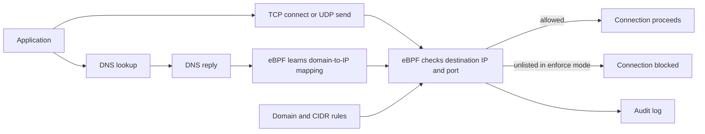

# outbound

`outbound` monitors and controls outgoing TCP and UDP connections on Linux. Use `audit` mode to see where applications connect, then switch to `enforce` to block destinations outside the domain and CIDR allowlist. It supports Linux `amd64` and `arm64` with systemd, cgroup v2, and the required eBPF hooks (kernel 5.17 or newer).

## How it works



Exact domains resolve at startup and refresh on the configured interval. Wildcard rules learn IPs from ordinary UDP DNS replies before the application uses them. The final decision uses the destination IP and port; audit events include the observed domain when it can be identified.

## Why it works

The eBPF hooks run at the socket boundary, before an outbound connection is authorized, so a blocked TCP connect or UDP send cannot proceed. Pinned eBPF links keep the selected policy attached if the daemon stops. A reboot removes those links until the service starts again.

This is an **IP-based** policy. A shared IP allowed for one domain can also be used to reach another service or proxy on that IP. DNS over HTTPS/TLS/TCP, cached answers, and direct-IP connections do not teach wildcard rules a domain. An observed domain is not proof of the HTTP Host or TLS SNI.

## Install on Ubuntu

Run on the VM. Replace `VERSION` with a published [release tag](https://github.com/opsbento/outbound/releases) containing the files in [`example/`](example/).

```sh
VERSION=vX.Y.Z
REPO=opsbento/outbound
case "$(uname -m)" in
  x86_64) ARCH=amd64 ;;
  aarch64) ARCH=arm64 ;;
  *) echo "Unsupported architecture" >&2; exit 1 ;;
esac
ASSET="outbound-${VERSION}-linux-${ARCH}"
BASE="https://github.com/${REPO}/releases/download/${VERSION}"
curl -fL --retry 3 -O "${BASE}/${ASSET}"
DIGEST=$(curl -fsSL "https://api.github.com/repos/${REPO}/releases/tags/${VERSION}" | python3 -c 'import json,re,sys; name=sys.argv[1]; assets=[a for a in json.load(sys.stdin)["assets"] if a["name"]==name]; assert len(assets)==1 and re.fullmatch(r"sha256:[0-9a-fA-F]{64}", assets[0]["digest"]); print(assets[0]["digest"].split(":",1)[1])' "$ASSET") || exit 1
printf '%s  %s\n' "$DIGEST" "$ASSET" | sha256sum --check || exit 1
RAW="https://raw.githubusercontent.com/${REPO}/${VERSION}/example"
for file in config.example.yaml outbound.service outbound.logrotate; do
  curl -fL --retry 3 -O "${RAW}/${file}" || exit 1
done
```

Review `config.example.yaml` and replace the documentation-only CIDRs before enabling enforcement. Install the files:

```sh
sudo groupadd --system --force outbound
id -u outbound >/dev/null 2>&1 || sudo useradd --system --no-create-home --shell /usr/sbin/nologin --gid outbound outbound
sudo install -d -m 0755 /etc/outbound
sudo install -d -o outbound -g outbound -m 0750 /var/log/outbound
sudo install -m 0755 "$ASSET" /usr/local/bin/outbound
sudo install -m 0644 config.example.yaml /etc/outbound/config.yaml
sudo install -m 0644 outbound.service /etc/systemd/system/outbound.service
sudo install -m 0644 outbound.logrotate /etc/logrotate.d/outbound
sudo /usr/local/bin/outbound --check-config --config /etc/outbound/config.yaml
sudo systemctl daemon-reload
sudo systemctl enable --now outbound
```

## Configure and verify

Edit `/etc/outbound/config.yaml`. The [example config](example/config.example.yaml) starts in `audit` mode. Domain or CIDR entries can be strings (any port) or objects with `ports` (up to 16 ports):

```yaml
allowlist:
  domains:
    - "*.amazonaws.com"
    - domain: "*.example.com"
      ports: [1138, 2218]
  cidrs:
    - cidr: "169.254.169.254/32" # GCE DNS resolver
      ports: [53]
    - cidr: "10.10.10.10/32" # SSH destination
      ports: [22, 2222]
```

`*.amazonaws.com` does not include `amazonaws.com` itself. The hooks cover TCP and UDP ports; `cover_all_udp: true` is required. Loopback, including `127.0.0.53`, is exempt. On GCE, allow the upstream resolver at `169.254.169.254:53`; on other hosts, check `resolvectl dns` and allow the actual upstream resolver on port 53.

After reviewing the audit log, set `settings.mode` to `enforce`, then validate and restart:

```sh
sudo /usr/local/bin/outbound --check-config --config /etc/outbound/config.yaml
sudo systemctl restart outbound
sudo systemctl is-active outbound
sudo /usr/local/bin/outbound --policy-status
sudo tail -f /var/log/outbound/outbound.log
```

The log is JSON Lines. `outgoing_traffic` shows `ALLOW`, `WOULD_BLOCK` (audit mode), or `BLOCK` (enforce mode). When a domain is known, attempts with the same domain, port, and decision within one drain are grouped into one record with `transports` and `ip_count`. Direct-IP traffic includes `destination_ip`. This is a destination summary, not a per-process or per-connection trail. Service and policy events carry policy hashes for audit correlation.

To intentionally remove enforcement, stop the service and detach the pinned policy from a trusted session:

```sh
sudo systemctl stop outbound
sudo /usr/local/bin/outbound --detach-policy
```

## License

[GPL-2.0-only](LICENSE).
